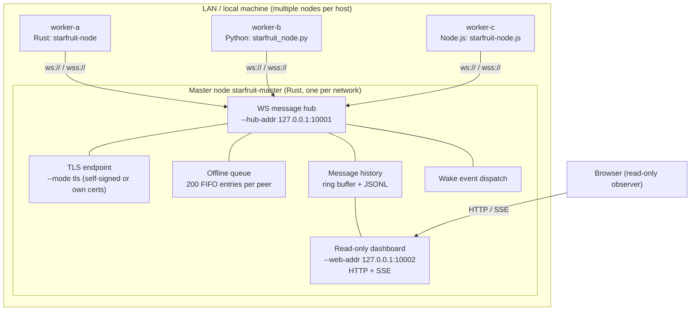
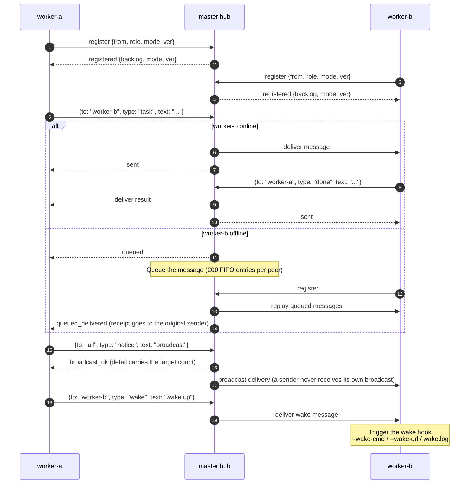
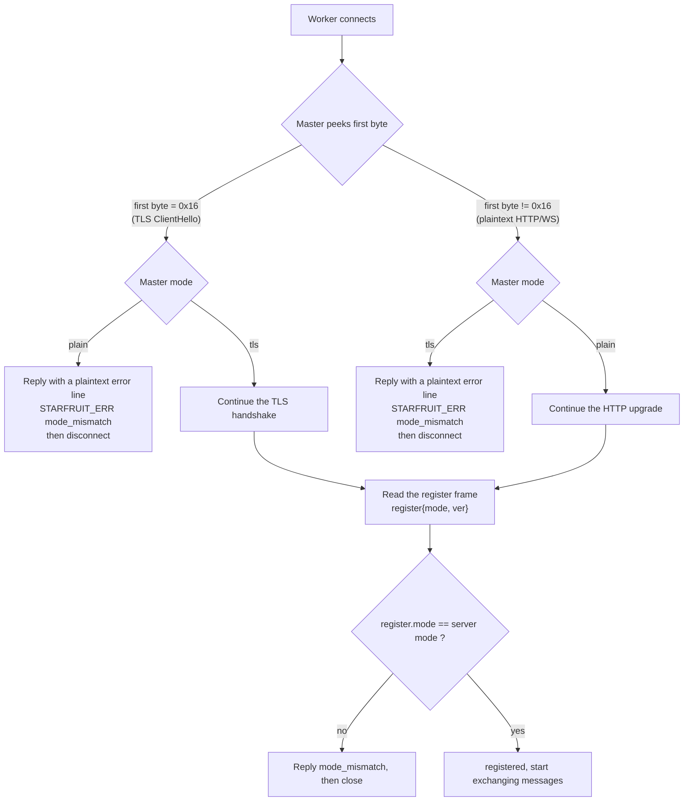

# starfruit — Multi-Node WebSocket Collaboration Skill


[](LICENSE)
[](master/)
[](nodes/python/)
[](nodes/nodejs/)

⭐ **A star-topology message hub**: **one master node (Rust) + any number of worker nodes
(Rust / Python / Node.js)**. Built for LAN multi-node collaboration (multiple nodes per machine),
with encrypted / non-encrypted dual modes (a mode mismatch is **reported back to the peer**),
a read-only web dashboard (animated message flow), an offline queue, message history and wake hooks.

- **Runs as installed**: Rust components are built locally with `cargo build` (no prebuilt binaries);
  the Python / Node.js workers are **dependency-free**;
- **Runs in the background**: every node is a daemon detached from any agent session; wake hooks are
  left for the agent to wire up;
- **Open source**: licensed under [MIT](LICENSE); contributions are welcome (see [CONTRIBUTING.md](CONTRIBUTING.md)).

> This is the English translation of [README.md](README.md). If the two disagree, the Chinese
> version is authoritative.

---

## Table of contents

- [Key features](#key-features)
- [Architecture](#architecture)
- [Message flow (sequence)](#message-flow-sequence)
- [Connection & mode validation](#connection--mode-validation)
- [Quick start](#quick-start)
- [Detailed usage](#detailed-usage)
  - [Master options](#master-options-starfruit-master)
  - [Worker options](#worker-options)
  - [Run modes (plain / tls)](#run-modes-plain--tls)
  - [Deploy modes and listen address rules](#deploy-modes-and-listen-address-rules)
  - [JWT token verification](#jwt-token-verification)
  - [Three deployment scenarios](#three-deployment-scenarios)
  - [Wake hooks](#wake-hooks-agent-integration-point)
  - [Running as a daemon](#running-as-a-daemon)
  - [Read-only web dashboard](#read-only-web-dashboard)
- [Protocol summary](#protocol-summary)
- [Repository layout](#repository-layout)
- [Development & testing](#development--testing)
- [Documentation map](#documentation-map)
- [License](#license)

---

## Key features

| Feature | Description |
|---|---|
| **Star topology** | A single master node (hub) routes all messages; any number of workers connect; **one machine can host several nodes** |
| **Multi-language workers** | Three equivalent implementations in Rust / Python 3 / Node.js ≥18, identical protocol, pick any one |
| **Dual run modes** | `plain` (unencrypted `ws://`) and `tls` (encrypted `wss://`); on a mode mismatch the hub **reports the error to the peer** and disconnects |
| **Offline queue** | Messages for an offline peer are queued (200 FIFO entries per peer) and replayed once that peer reconnects and registers |
| **Message history** | In-memory ring buffer (5000 entries by default) plus an unbounded JSONL file; the dashboard pages through it |
| **Read-only dashboard** | Node topology, animated message flow, history and stats; **no auth, read-only**, exposes no write operations |
| **Wake hooks** | On `type=wake` a node runs a command / HTTP callback / sentinel file write, so an agent can be woken |
| **Daemon mode** | `--daemon` detaches from the terminal and writes a pidfile plus logs; systemd / nohup also documented |
| **No extra dependencies** | Workers use only their standard library (hand-rolled RFC6455); the hub embeds its static assets into the binary |
| **Deploy modes** | `--deploy local\|lan\|public`: `local` binds loopback only (safest), `lan` binds a specific LAN IP, `public` requires a concrete IP plus `--mode tls` and JWT; wildcard `0.0.0.0` is always rejected |
| **JWT tokens** | Master-issued HS256 tokens; workers must present `--token <token>`; the master verifies signature / expiry / owner and replies `unauthorized` then disconnects on failure |

---

## Architecture



**Roles**

| Role | Count | Responsibility |
|---|---|---|
| **Master (manager / hub)** | exactly one | Message routing, offline queue, history, TLS endpoint, read-only web dashboard, wake dispatch, built-in manager endpoint |
| **Worker** | any | Connects, registers, takes tasks, executes and reports; implemented in any language by an agent, script or tool |

> Node names are **unique network-wide**: reconnecting with the same name **evicts the old connection**
> (which receives a Close frame).

---

## Message flow (sequence)



---

## Connection & mode validation

The master validates encrypted / non-encrypted compatibility with **two independent layers**
(see [docs/protocol.md](docs/protocol.md) §2.1):



---

## Quick start

> The full skill description is in [SKILL.md](SKILL.md) (Chinese); daemon and wake details are in
> [docs/daemon.md](docs/daemon.md) (Chinese).

### 1) Build (Rust components, run locally)

```bash
cd master      && cargo build --release     # produces master/target/release/starfruit-master
cd nodes/rust  && cargo build --release     # produces nodes/rust/target/release/starfruit-node
```

> The Python / Node.js workers need **no build step** — just run them with the corresponding interpreter.

### 2) Start the master (the single manager)

```bash
# Local-only by default (safest): --deploy local binds loopback only —
# hub 127.0.0.1:10001 + dashboard 127.0.0.1:10002
./master/target/release/starfruit-master --deploy local --mode plain --daemon

# Encrypted mode: a self-signed certificate is generated on first start (or supply --cert/--key)
./master/target/release/starfruit-master --deploy local --mode tls --daemon

# Other machines on the LAN need to join: --deploy lan + bind your LAN IP (do not use 0.0.0.0)
./master/target/release/starfruit-master --deploy lan --mode plain --hub-addr 192.168.1.10:10001 --daemon

# Public access: --deploy public requires --mode tls and JWT; issue a token per worker first
./master/target/release/starfruit-master --issue-token worker-a          # prints a token, then exits
./master/target/release/starfruit-master --deploy public --mode tls --hub-addr 127.0.0.1:10001 --daemon
```

On success the master prints a **startup notice** in the session: master name, run mode, hub and
dashboard addresses, data directory, join commands for the three worker implementations, and the
bind-address rules.

### 3) Start workers (pick any implementation — they are equivalent)

```bash
# Rust
./nodes/rust/target/release/starfruit-node --name worker-a --mode plain \
  --server ws://127.0.0.1:10001 \
  --wake-cmd 'echo "$SF_FROM: $SF_TEXT" >> /path/to/agent-inbox.log'

# Python (dependency-free)
python3 nodes/python/starfruit_node.py --name worker-b --mode plain \
  --server ws://127.0.0.1:10001

# Node.js (dependency-free)
node nodes/nodejs/starfruit-node.js --name worker-c --mode plain \
  --server ws://127.0.0.1:10001
```

> **Which implementation to use is the agent's decision, based on the machine's environment**:
> use Rust where a Rust toolchain exists, Python where only Python is available, Node.js where only
> Node is available. All three speak the exact same protocol.

### 4) Open the dashboard

```bash
open http://127.0.0.1:10002     # https:// under tls mode; the browser must trust the self-signed cert
```

---

## Detailed usage

### Master options (`starfruit-master`)

| Option | Default | Description |
|---|---|---|
| `--deploy local\|lan\|public` | `local` | Deployment mode: `local` binds loopback only (safest), `lan` binds a LAN IP, `public` requires a concrete IP + `--mode tls` + JWT (see [Deploy modes](#deploy-modes-and-listen-address-rules)) |
| `--mode plain\|tls` | `plain` | Run mode: unencrypted `ws://` / encrypted `wss://` |
| `--hub-addr <addr>` | `127.0.0.1:10001` | Bind address of the WS hub (`0.0.0.0` is **rejected**; port must be ≥ 10001, auto +1 if in use) |
| `--web-addr <addr>` | `127.0.0.1:10002` | Bind address of the read-only dashboard (`0.0.0.0` is **rejected**; port must be ≥ 10001, auto +1 if in use) |
| `--cert <path>` | auto-generated | TLS certificate PEM (a self-signed cert is created under `--data-dir` by default) |
| `--key <path>` | auto-generated | TLS private key PEM (provide together with `--cert`) |
| `--jwt-secret <s>` | auto-generated | JWT signing secret; if omitted, a 32-byte random hex secret is generated at `data-dir/jwt-secret` (mode 0600) |
| `--jwt-ttl <secs>` | `86400` | JWT token lifetime in seconds |
| `--require-jwt` | off | Force JWT verification in `local` / `lan` mode (`public` mode is always on) |
| `--issue-token <node>` | none | Issue a JWT token for the named node, print it and exit (does not start the service) |
| `--data-dir <dir>` | `./starfruit-data` | Runtime data directory (logs / pid / history / wake) |
| `--manager-name <name>` | `manager` | Registration name of the built-in manager endpoint |
| `--wake-cmd <shell>` | none | Wake hook: run a command (`SF_FROM/SF_TO/SF_TEXT/SF_TS` injected) |
| `--wake-url <url>` | none | Wake hook: HTTP POST JSON |
| `--history-cap <n>` | `5000` | In-memory history entries for the dashboard (the JSONL file is unbounded) |
| `--daemon` | off | Run in the background (detached; logs to `data-dir/starfruit-master.log`) |
| `-h, --help` | — | Show help |

### Worker options

All three implementations share the same options:

| Option | Default | Description |
|---|---|---|
| `--server <url>` | `ws://127.0.0.1:10001` | Master address (`ws://` or `wss://`; use the master's LAN IP / tunnel domain across machines) |
| `--name <name>` | required | Node name, **unique network-wide** (reconnecting with the same name evicts the old connection) |
| `--role <role>` | `worker` | Role label (`manager` / `worker`, display only) |
| `--mode plain\|tls` | `plain` | **Must match the master**, otherwise the master reports an error and disconnects |
| `--token <jwt>` | none | JWT token issued by the master (`--issue-token <this node's name>`); required whenever the master enforces JWT |
| `--data-dir <dir>` | `./starfruit-data` | Runtime data directory (logs / pid / `wake.log`) |
| `--wake-cmd <sh>` | none | Wake hook: shell command (`SF_FROM/SF_TO/SF_TEXT/SF_TS` injected) |
| `--wake-url <url>` | none | Wake hook: HTTP POST JSON `{"from","to","text","ts"}` |
| `--ca-cert <path>` | none | TLS CA certificate (self-signed certs are trusted by default, which suits LAN use) |
| `--daemon` | off | Run in the background (detached; pidfile + logs) |
| `-h, --help` | — | Show help |

### Run modes (plain / tls)

| Mode | Transport | Suitable for |
|---|---|---|
| `plain` | `ws://` | Trusted LAN / local machine only |
| `tls` | `wss://` | Across machines, public exposure (tunnel) or untrusted networks |

- The master's `--mode` selects the service mode; a worker's `--mode` **must match**, otherwise the
  master **reports the error to that worker** (a transport-level error line plus an application-level
  `mode_mismatch` receipt — two independent layers, see [protocol §2.1](docs/protocol.md)).
- In `tls` mode a self-signed certificate is generated on first start and can be replaced with your own
  via `--cert` / `--key`; workers trust self-signed certificates by default, or can pin a CA with `--ca-cert`.

### Deploy modes and listen address rules

`--deploy` selects how far the node is exposed. The default (and safest) is `local`.

| `--deploy` | `--hub-addr` / `--web-addr` | tls | jwt | Notes |
|---|---|---|---|---|
| `local` (**default**) | loopback only (`127.0.0.1`) | optional | optional | Safest; other machines cannot connect. A non-loopback address is **rejected** |
| `lan` | the host's LAN IP (e.g. `192.168.1.10`); a loopback address is **rejected** | optional | optional | Lets other LAN machines join; `0.0.0.0` is forbidden |
| `public` | a concrete IP (a concrete `127.0.0.1` is fine behind a tunnel) | **required** (`--mode tls`) | **forced on** | Meant for Cloudflare Tunnel; a public deploy without tls aborts start-up (exit code 1) |

Ports: every mode defaults to `10001` for the hub and `10002` for the dashboard, must be ≥ `10001`,
and are auto-incremented by 1 when a port is already in use (up to 100 tries).

> ⛔ **Never bind `0.0.0.0`** (nor `::`): the master **refuses** wildcard addresses and exits with
> code 1, preventing accidental exposure on every interface. When bound to a non-local address in
> `plain` mode, the master additionally prints a `[warn]` line.

### JWT token verification

- **When it is enforced**: `public` deploy mode always enforces it; `local` / `lan` are optional and
  can be turned on with `--require-jwt`. When enforced, every worker must register with a valid
  `token` field.
- **Issuing (master only)**: tokens can only be signed by the master, and only a matching secret
  validates them. Print one with
  `starfruit-master --issue-token <node> [--jwt-secret <s>] [--jwt-ttl <secs>]` (it prints the token
  and exits without starting the service).
- **Using (worker)**: start the worker with `--token <token>` (all three clients support it).
- **Algorithm & claims**: HS256; `iss=starfruit-master`, `sub=<node name>`, `iat`, `exp`
  (`--jwt-ttl`, default `86400` seconds). A token is not transferable between nodes (the `sub` is
  checked) and an expired token is rejected.
- **Secret**: `--jwt-secret` if given, otherwise generated automatically as 32 random bytes (hex) at
  `data-dir/jwt-secret` with mode `0600`.
- **Failure semantics**: a missing or invalid token makes the master reply `unauthorized` and
  disconnect; the Rust / Python / Node.js clients exit with code 3.

### Three deployment scenarios

**Scenario A: local multi-agent (default, safest)**

```bash
# Master: --deploy local binds 127.0.0.1 only
./master/target/release/starfruit-master --deploy local --mode plain --daemon

# Workers on the same machine (names must be unique)
python3 nodes/python/starfruit_node.py --name agent-1 --mode plain --daemon
node    nodes/nodejs/starfruit-node.js --name agent-2 --mode plain --daemon
```

**Scenario B: multi-machine LAN collaboration**

```bash
# Master: --deploy lan + bind the host's LAN IP (example: 192.168.1.10)
./master/target/release/starfruit-master --deploy lan --mode plain \
  --hub-addr 192.168.1.10:10001 --web-addr 192.168.1.10:10002 --daemon

# Workers on other machines: point --server at the master's LAN IP
python3 nodes/python/starfruit_node.py --name worker-b --mode plain \
  --server ws://192.168.1.10:10001 --daemon
```

**Scenario C: public access (Cloudflare Tunnel + encryption + JWT)**

```bash
# Master: --deploy public, still bound to a local address (the tunnel forwards traffic;
# do not bind 0.0.0.0). Public mode requires --mode tls and enforces JWT.
./master/target/release/starfruit-master --deploy public --mode tls --hub-addr 127.0.0.1:10001 --daemon

# Issue a token for each worker (prints the token, then exits; not tied to the running service)
./master/target/release/starfruit-master --issue-token worker-b

# Expose local port 10001 through Cloudflare Tunnel (example)
cloudflared tunnel --url http://127.0.0.1:10001
# Remote workers connect to the tunnel domain over wss:// with --mode tls and --token
./nodes/rust/target/release/starfruit-node --name worker-b --mode tls \
  --server wss://<tunnel-domain> --token <token> --daemon
```

> Public exposure **must** use `tls` and JWT; `plain` is only advisable on a trusted LAN.

### Wake hooks (agent integration point)

When a node receives a `type=wake` message, it triggers one of the configured hooks:

| Kind | Configuration | Behaviour |
|---|---|---|
| Command | `--wake-cmd '<shell>'` | Runs as a child process; `SF_FROM` / `SF_TO` / `SF_TEXT` / `SF_TS` are injected |
| HTTP | `--wake-url <url>` | `POST` JSON `{"from","to","text","ts"}` |
| Sentinel file | on by default | Appends one JSONL line to `<data-dir>/wake.log`; an agent can `tail -f` it to wake a session |

**Recommended integration**: point `--wake-cmd` at your own wake entrypoint (the CLI / script that
starts a session), or watch `wake.log`. The node itself is not tied to any specific agent.

### Running as a daemon

```bash
# Master in the background (writes data-dir/starfruit-master.pid and starfruit-master.log)
./master/target/release/starfruit-master --mode plain --daemon

# Worker in the background (writes data-dir/<name>.pid and <name>.log)
python3 nodes/python/starfruit_node.py --name worker-b --mode plain --daemon
```

Processes are independent of any agent session; systemd unit examples and the nohup approach are in
[docs/daemon.md](docs/daemon.md) (Chinese).

### Read-only web dashboard

- URL: `http://127.0.0.1:10002` (`https://` in `tls` mode);
- **No auth, read-only**: node topology (canvas particle animation), message flow, history
  (paging / filtering) and stats;
- Main endpoints: `GET /`, `GET /api/nodes`, `GET /api/messages?limit=&before=`, `GET /events` (SSE).

---

## Protocol summary

See [docs/protocol.md](docs/protocol.md) for the full starfruit protocol v2.

- **Frame**: JSON text `{"from","to","type","text","ts"}`; `to` accepts `"all"` for broadcast
  (a sender never receives its own broadcast);
- **Types**: `task / status / done / blocked / idle / notice / chat / wake`;
- **Register**: first frame `{"action":"register","from":"<name>","role":"worker|manager","mode":"plain|tls","ver":2}`,
  plus an optional `"token":"<jwt>"` field whenever the master enforces JWT;
- **Receipts**: `registered / sent / queued / queued_delivered / broadcast_ok / no_such_peer / bad_msg / warn / mode_mismatch / unauthorized`;
- **Offline queue**: messages for an offline peer are queued (200 FIFO entries per peer) and delivered
  after it registers; broadcasts are not replayed.

---

## Repository layout

```
starfruit/
├── SKILL.md / README.md / README.en.md
├── LICENSE / CHANGELOG.md / VERSION / TODO.md
├── CONTRIBUTING.md / CODE_OF_CONDUCT.md / SECURITY.md
├── docs/            # protocol, methodology, plan, naming, daemon, workflow
│   └── assets/      # static assets such as the README promo image
├── master/          # master node (Rust): hub + TLS + history + web dashboard + daemon
├── nodes/
│   ├── rust/        # Rust worker (cargo build)
│   ├── python/      # Python worker (dependency-free)
│   └── nodejs/      # Node.js worker (dependency-free, Node >= 18)
├── tests/           # end-to-end script (tests/e2e.sh) and dual-mode check
└── reference/       # archived history (legacy ws-hub v0.2.0, original protocol/notes)
```

---

## Development & testing

```bash
# Master: build / lint / unit tests
cd master      && cargo build --release && cargo clippy -- -D warnings && cargo test

# Rust worker
cd nodes/rust  && cargo build --release && cargo clippy -- -D warnings && cargo test

# End-to-end test (master + workers in three languages: register, send/receive,
# offline queue, bind-address rules, ...)
bash tests/e2e.sh
```

Project conventions (commit messages, documentation language, verification requirements) are in
[docs/workflow-optimized.md](docs/workflow-optimized.md) (Chinese).

---

## Documentation map

| Document | Contents |
|---|---|
| [SKILL.md](SKILL.md) | Skill entry point: components, quickstart, protocol summary, operations notes (Chinese) |
| [docs/protocol.md](docs/protocol.md) | starfruit protocol v2 (topology / dual mode / error semantics / receipts / wake) |
| [docs/skill-plan.md](docs/skill-plan.md) | Skill plan (feature list / design decisions / acceptance criteria) |
| [docs/naming.md](docs/naming.md) | Naming rationale (starfruit = a star-shaped cross-section = star topology) |
| [docs/daemon.md](docs/daemon.md) | Daemon operation (`--daemon` / systemd / nohup) and wake hooks |
| [docs/workflow-optimized.md](docs/workflow-optimized.md) | Workflow constraints for AI coding tools |
| [CONTRIBUTING.md](CONTRIBUTING.md) | Contribution guide |
| [SECURITY.md](SECURITY.md) | Security policy and vulnerability reporting |

---

## License

Released under the [MIT License](LICENSE). Issues and pull requests are welcome; please read
[CONTRIBUTING.md](CONTRIBUTING.md) and [CODE_OF_CONDUCT.md](CODE_OF_CONDUCT.md) first.

For security issues, please report privately as described in [SECURITY.md](SECURITY.md).
