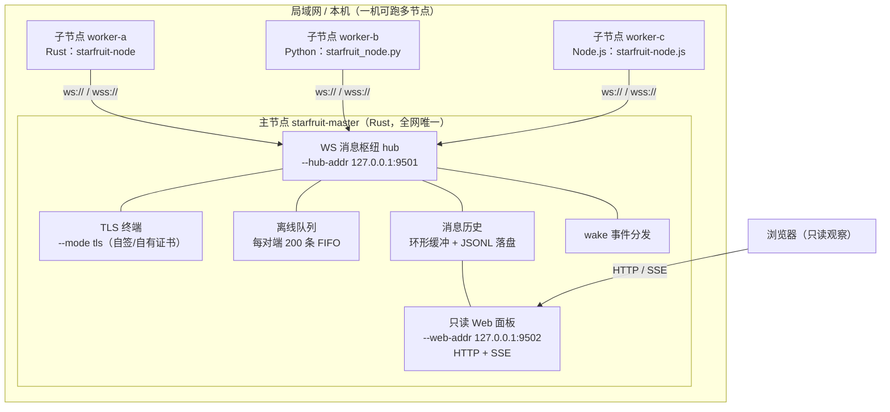
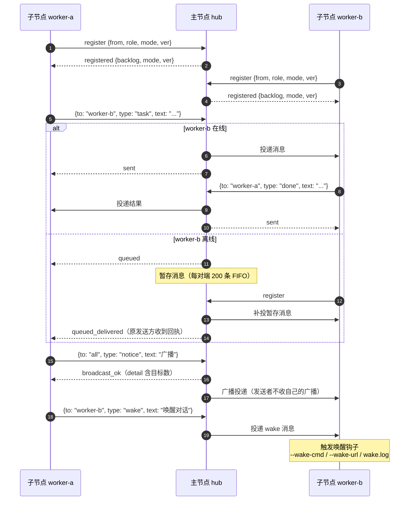
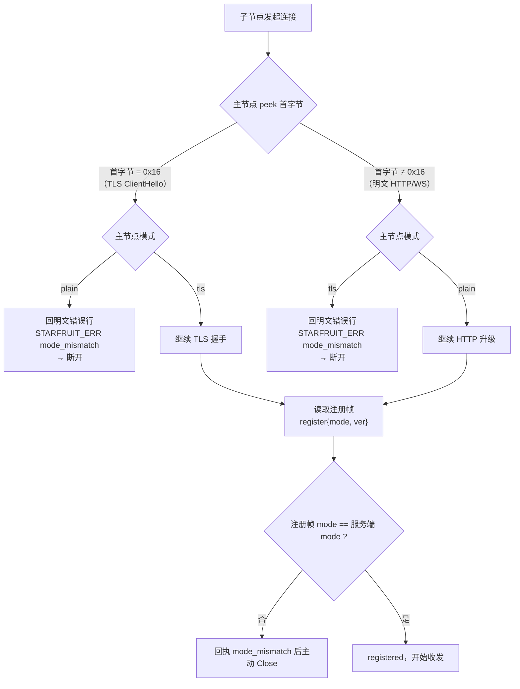

# starfruit（杨桃）—— 多节点 WS 协同 SKILL


[](LICENSE)
[](master/)
[](nodes/python/)
[](nodes/nodejs/)

⭐ **星型拓扑消息枢纽**：**唯一主节点（Rust）+ 多种子节点（Rust / Python / Node.js）**。
面向局域网多节点协同（一机可跑多节点）、加密/非加密双模式（模式不匹配**向对方报错**）、
只读 Web 可视化面板（消息流动画）、离线队列、消息历史、wake 唤醒钩子。

- **安装即用**：Rust 组件由用户本地 `cargo build`（不提供二进制）；Python / Node.js 子节点**零第三方依赖**；
- **后台常驻**：所有节点为脱离 agent 会话的后台进程，wake 钩子留给 agent 对接；
- **开源**：采用 [MIT 许可证](LICENSE)，欢迎[贡献](CONTRIBUTING.md)。

---

## 目录

- [核心特性](#核心特性)
- [系统架构](#系统架构)
- [消息流转（流程图）](#消息流转流程图)
- [连接与模式校验](#连接与模式校验)
- [快速开始](#快速开始)
- [详细使用说明](#详细使用说明)
  - [主节点参数](#主节点参数starfruit-master)
  - [子节点参数](#子节点参数starfruit-node--starfruit_nodepy--starfruit-nodejs)
  - [运行模式（plain / tls）](#运行模式plain--tls)
  - [监听地址规则（务必遵守）](#监听地址规则务必遵守)
  - [三种部署场景示例](#三种部署场景示例)
  - [唤醒钩子](#唤醒钩子agent-对接口子)
  - [后台运行](#后台运行脱离会话)
  - [Web 只读面板](#web-只读面板)
- [协议摘要](#协议摘要)
- [目录结构](#目录结构)
- [开发与测试](#开发与测试)
- [文档地图](#文档地图)
- [开源与许可](#开源与许可)

---

## 核心特性

| 特性 | 说明 |
|---|---|
| **星型拓扑** | 全网唯一主节点（hub）路由消息，任意多个子节点接入；**一台机器可跑多个节点** |
| **多语言子节点** | Rust / Python 3 / Node.js ≥18 三套等价实现，协议完全相同，任选其一 |
| **双运行模式** | `plain`（`ws://` 明文）与 `tls`（`wss://` 加密）；模式不匹配时**向对方报错**并断开 |
| **离线队列** | 定向消息对端不在线时暂存（每对端 200 条 FIFO），对端重连注册后自动补投 |
| **消息历史** | 内存环形缓冲（默认 5000 条）+ JSONL 落盘（不限量），面板可分页回看 |
| **只读 Web 面板** | 节点拓扑 + 消息流动画 + 历史与统计；**无鉴权、全只读**，不提供任何写操作 |
| **wake 唤醒钩子** | 收到 `type=wake` 时触发：执行命令 / HTTP 回调 / 写哨兵文件，供 agent 对接 |
| **后台守护** | `--daemon` 脱离终端，写 pidfile 与日志；亦提供 systemd / nohup 方式 |
| **零外部依赖** | 子节点仅用各语言标准库（裸实现 RFC6455）；主节点静态资源内嵌于二进制 |

---

## 系统架构



**职责划分**

| 角色 | 数量 | 职责 |
|---|---|---|
| **主节点 manager / hub** | 全网唯一 | 消息路由、离线队列、历史记录、TLS 终端、Web 只读面板、wake 事件分发、内置管理者端点 |
| **子节点 worker** | 任意 | 连接主节点、注册、领任务/执行/上报；由 agent、脚本或工具以任意语言接入 |

> 节点**名字全网唯一**：同名重连会**顶掉旧连接**（旧连接收到 Close 帧）。

---

## 消息流转（流程图）



---

## 连接与模式校验

主节点采用**双保险**判定加密/非加密模式是否匹配（详见 [docs/protocol.md](docs/protocol.md) §2.1）：



---

## 快速开始

> 完整技能说明见 [SKILL.md](SKILL.md)；后台运行与唤醒见 [docs/daemon.md](docs/daemon.md)。

### 1）编译（Rust 组件，本地执行）

```bash
cd master      && cargo build --release     # 产出 master/target/release/starfruit-master
cd nodes/rust  && cargo build --release     # 产出 nodes/rust/target/release/starfruit-node
```

> Python / Node.js 子节点**无需编译**，直接用对应解释器运行即可。

### 2）启动主节点（唯一管理者）

```bash
# 默认仅本机（最安全）：hub 127.0.0.1:9501 + 面板 127.0.0.1:9502
./master/target/release/starfruit-master --mode plain --daemon

# 加密模式：首次启动自动生成自签证书（或用 --cert/--key 指定）
./master/target/release/starfruit-master --mode tls --daemon

# 局域网内其它机器需要加入：监听本机局域网 IP（不要用 0.0.0.0）
./master/target/release/starfruit-master --mode plain --hub-addr 192.168.1.10:9501 --daemon
```

启动成功后，会话中会打印**启动说明**：主节点名称、运行模式、消息枢纽与面板地址、数据目录、
三语言子节点加入命令，以及监听地址规则。

### 3）启动子节点（任选一种实现，功能等价）

```bash
# Rust
./nodes/rust/target/release/starfruit-node --name worker-a --mode plain \
  --wake-cmd 'echo "$SF_FROM: $SF_TEXT" >> /path/to/agent-inbox.log'

# Python（零第三方依赖）
python3 nodes/python/starfruit_node.py --name worker-b --mode plain

# Node.js（零第三方依赖）
node nodes/nodejs/starfruit-node.js --name worker-c --mode plain
```

> **客户端选哪种实现由 agent 按所在机器环境决定**：有 Rust 工具链用 Rust 版；只有 Python 用 Python 版；
> 只有 Node 用 Node.js 版。三者协议完全相同，任选其一。

### 4）打开面板

```bash
open http://127.0.0.1:9502     # tls 模式为 https://，自签证书需浏览器信任
```

---

## 详细使用说明

### 主节点参数（`starfruit-master`）

| 参数 | 默认值 | 说明 |
|---|---|---|
| `--mode plain\|tls` | `plain` | 运行模式：非加密 `ws://` / 加密 `wss://` |
| `--hub-addr <addr>` | `127.0.0.1:9501` | WS 消息枢纽监听地址（**禁止 `0.0.0.0`**） |
| `--web-addr <addr>` | `127.0.0.1:9502` | Web 只读面板监听地址（**禁止 `0.0.0.0`**） |
| `--cert <path>` | 自动生成 | TLS 证书 PEM（缺省在 `--data-dir` 生成自签证书） |
| `--key <path>` | 自动生成 | TLS 私钥 PEM（与 `--cert` 成对提供） |
| `--data-dir <dir>` | `./starfruit-data` | 运行数据目录（日志 / pid / 历史 / wake） |
| `--manager-name <name>` | `manager` | 内置管理者端点的注册名 |
| `--wake-cmd <shell>` | 无 | wake 唤醒钩子：执行命令（注入 `SF_FROM/SF_TO/SF_TEXT/SF_TS`） |
| `--wake-url <url>` | 无 | wake 唤醒钩子：HTTP POST JSON |
| `--history-cap <n>` | `5000` | 面板内存历史条数（JSONL 落盘不限量） |
| `--daemon` | 关 | 后台运行（脱离终端，日志写入 `data-dir/starfruit-master.log`） |
| `-h, --help` | — | 显示帮助 |

### 子节点参数（`starfruit-node` / `starfruit_node.py` / `starfruit-node.js`）

三套实现参数一致：

| 参数 | 默认值 | 说明 |
|---|---|---|
| `--server <url>` | `ws://127.0.0.1:9501` | 主节点地址（`ws://` 或 `wss://`；跨机填主节点局域网 IP / Tunnel 域名） |
| `--name <name>` | 必填 | 节点名，**全网唯一**（同名重连顶掉旧连接） |
| `--role <role>` | `worker` | 角色标签（`manager` / `worker`，展示用） |
| `--mode plain\|tls` | `plain` | **必须与主节点一致**，否则连接时会被主节点报错断开 |
| `--data-dir <dir>` | `./starfruit-data` | 运行数据目录（日志 / pid / `wake.log`） |
| `--wake-cmd <sh>` | 无 | wake 唤醒钩子：shell 命令（注入 `SF_FROM/SF_TO/SF_TEXT/SF_TS`） |
| `--wake-url <url>` | 无 | wake 唤醒钩子：HTTP POST JSON `{"from","to","text","ts"}` |
| `--ca-cert <path>` | 无 | TLS CA 证书（缺省信任自签证书，适用于 LAN） |
| `--daemon` | 关 | 后台运行（脱离终端，pidfile + 日志） |
| `-h, --help` | — | 显示帮助 |

### 运行模式（plain / tls）

| 模式 | 传输 | 适用场景 |
|---|---|---|
| `plain` | `ws://` | 可信局域网 / 仅本机 |
| `tls` | `wss://` | 跨机、公网（Tunnel）或不信任的网络 |

- 主节点 `--mode` 决定服务模式；**子节点 `--mode` 必须一致**，否则主节点会**向该节点报错**
  （传输层错误行 + 应用层 `mode_mismatch` 回执，双保险，见 [协议 §2.1](docs/protocol.md)）。
- `tls` 模式首次启动自动生成自签证书，可用 `--cert` / `--key` 替换为自有证书；
  子节点默认信任自签证书，也可用 `--ca-cert` 固定校验。

### 监听地址规则（务必遵守）

| 场景 | `--hub-addr` / `--web-addr` | 说明 |
|---|---|---|
| 仅本机多 agent 工具使用 | `127.0.0.1`（**默认**） | 最安全，其它机器无法接入 |
| 局域网内多机协同 | 本机局域网 IP（如 `192.168.1.10`） | 供局域网其它机器加入 |
| 需要公网支持 | 本机地址 + **Cloudflare Tunnel** | 由 Tunnel 暴露公网，**必须** `--mode tls` |

> ⛔ **禁止直接监听 `0.0.0.0`**（含 `::`）：主节点启动时会**拒绝**通配地址并退出（退出码 1），
> 避免无意中把服务暴露到所有网卡。明文（`plain`）监听非本机地址时，主节点会额外输出 `[warn]` 提示。

### 三种部署场景示例

**场景 A：仅本机多 agent（默认，最安全）**

```bash
# 主节点：只监听 127.0.0.1
./master/target/release/starfruit-master --mode plain --daemon

# 子节点（同机多开，名字必须唯一）
python3 nodes/python/starfruit_node.py --name agent-1 --mode plain --daemon
node    nodes/nodejs/starfruit-node.js --name agent-2 --mode plain --daemon
```

**场景 B：局域网多机协同**

```bash
# 主节点：监听本机局域网 IP（示例 192.168.1.10）
./master/target/release/starfruit-master --mode plain \
  --hub-addr 192.168.1.10:9501 --web-addr 192.168.1.10:9502 --daemon

# 其它机器上的子节点：--server 指向主节点局域网 IP
python3 nodes/python/starfruit_node.py --name worker-b --mode plain \
  --server ws://192.168.1.10:9501 --daemon
```

**场景 C：公网访问（Cloudflare Tunnel + 加密）**

```bash
# 主节点：加密模式，仍只监听本机地址（由 Tunnel 转发，不要监听 0.0.0.0）
./master/target/release/starfruit-master --mode tls --hub-addr 127.0.0.1:9501 --daemon

# 用 Cloudflare Tunnel 把本机 9501 暴露为公网域名（示例）
cloudflared tunnel --url http://127.0.0.1:9501
# 公网侧子节点连接 Tunnel 域名，使用 wss:// 且 --mode tls
```

> 公网必须使用 **tls 加密模式**；明文 `plain` 仅建议用于可信局域网。

### 唤醒钩子（agent 对接口子）

节点收到 `type=wake` 消息时，按配置触发其一：

| 方式 | 配置 | 行为 |
|---|---|---|
| 命令 | `--wake-cmd '<shell>'` | 以子进程执行；环境变量注入 `SF_FROM` / `SF_TO` / `SF_TEXT` / `SF_TS` |
| HTTP | `--wake-url <url>` | `POST` JSON `{"from","to","text","ts"}` |
| 哨兵文件 | 默认开启 | 追加一行 JSONL 到 `<data-dir>/wake.log`，agent 可 `tail -f` 唤醒会话 |

**推荐对接方式**：把 `--wake-cmd` 指向自己的唤醒入口（拉起会话的 CLI / 脚本），
或监控 `wake.log`。节点本身不绑定任何具体 agent 实现。

### 后台运行（脱离会话）

```bash
# 主节点后台运行（写 data-dir/starfruit-master.pid 与 starfruit-master.log）
./master/target/release/starfruit-master --mode plain --daemon

# 子节点后台运行（写 data-dir/<name>.pid 与 <name>.log）
python3 nodes/python/starfruit_node.py --name worker-b --mode plain --daemon
```

进程与任何 agent 会话生命周期无关；systemd unit 示例与 nohup 方式见 [docs/daemon.md](docs/daemon.md)。

### Web 只读面板

- 地址：`http://127.0.0.1:9502`（`tls` 模式下为 `https://`）；
- **无鉴权、全只读**：节点拓扑（canvas 粒子动画）、消息流转、消息历史（分页/筛选）、统计；
- 主要端点：`GET /`、`GET /api/nodes`、`GET /api/messages?limit=&before=`、`GET /events`（SSE）。

---

## 协议摘要

详见 [docs/protocol.md](docs/protocol.md)（starfruit 协议 v2）。

- **帧**：JSON 文本 `{"from","to","type","text","ts"}`；`to` 支持 `"all"` 广播（发送者不收自己的广播）；
- **类型**：`task / status / done / blocked / idle / notice / chat / wake`；
- **注册**：首帧 `{"action":"register","from":"<name>","role":"worker|manager","mode":"plain|tls","ver":2}`；
- **回执**：`registered / sent / queued / queued_delivered / broadcast_ok / no_such_peer / bad_msg / warn / mode_mismatch`；
- **离线队列**：定向消息对端不在线时暂存（每对端 200 条 FIFO），注册后自动投递；广播不补发。

---

## 目录结构

```
starfruit/
├── SKILL.md / README.md / README.en.md
├── LICENSE / CHANGELOG.md / VERSION / TODO.md
├── CONTRIBUTING.md / CODE_OF_CONDUCT.md / SECURITY.md
├── docs/            # 协议、方法论、规划、命名、守护、工作流
│   └── assets/      # README 宣传图等静态资源
├── master/          # 主节点（Rust）：hub + TLS + 历史 + Web 面板 + daemon
├── nodes/
│   ├── rust/        # 子节点 Rust（cargo build）
│   ├── python/      # 子节点 Python（零第三方依赖）
│   └── nodejs/      # 子节点 Node.js（零第三方依赖，Node ≥ 18）
├── tests/           # 端到端脚本（tests/e2e.sh）与双模式校验脚本
└── reference/       # 历史归档（legacy ws-hub v0.2.0、原协议/经验文档）
```

---

## 开发与测试

```bash
# 主节点：构建 / 静态检查 / 单元测试
cd master      && cargo build --release && cargo clippy -- -D warnings && cargo test

# 子节点（Rust）
cd nodes/rust  && cargo build --release && cargo clippy -- -D warnings && cargo test

# 端到端测试（启动主节点 + 三语言子节点，校验注册/收发/离线队列/监听规则等）
bash tests/e2e.sh
```

开发规范（提交信息、文档语言、验证要求等）见 [docs/workflow-optimized.md](docs/workflow-optimized.md)。

---

## 文档地图

| 文档 | 内容 |
|---|---|
| [SKILL.md](SKILL.md) | 技能入口：组件、Quickstart、协议摘要、运维须知 |
| [docs/protocol.md](docs/protocol.md) | starfruit 协议 v2（拓扑 / 双模式 / 报错语义 / 回执码 / wake） |
| [docs/2026-11-12-多Agent-WS协同开发全流程经验总结.md](docs/2026-11-12-多Agent-WS协同开发全流程经验总结.md) | 方法论来源（管理者 / 执行者 / 巡检 / 验收 / 陷阱） |
| [docs/skill-plan.md](docs/skill-plan.md) | SKILL 规划书（功能清单 / 设计决策 / 验收标准） |
| [docs/naming.md](docs/naming.md) | 命名说明（starfruit = 杨桃横切面五角星 = 星型拓扑） |
| [docs/daemon.md](docs/daemon.md) | 后台运行（`--daemon` / systemd / nohup）与 wake 唤醒钩子 |
| [docs/workflow-optimized.md](docs/workflow-optimized.md) | AI 编码工具工作流约束 |
| [CONTRIBUTING.md](CONTRIBUTING.md) | 贡献指南 |
| [SECURITY.md](SECURITY.md) | 安全策略与漏洞上报 |

---

## 开源与许可

本项目采用 [MIT 许可证](LICENSE)。欢迎提交 Issue 与 Pull Request，参与前请阅读
[CONTRIBUTING.md](CONTRIBUTING.md) 与 [CODE_OF_CONDUCT.md](CODE_OF_CONDUCT.md)。

安全相关问题请按 [SECURITY.md](SECURITY.md) 的方式私下上报。
